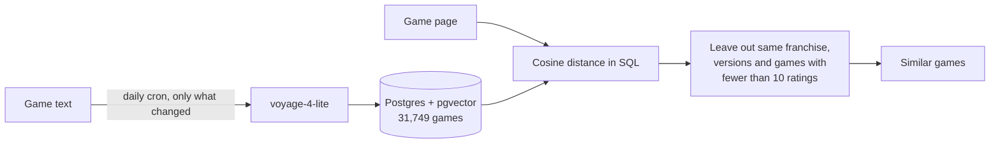

# Game similarity evaluation

How I measured and improved the "similar games" feature of [Checkpointd](https://www.checkpointd.com), a game tracking site with web and mobile apps. Checkpointd's code is private, so this repository holds only the evaluation: golden set, scripts, notebook and results.

The fine-tuned model is on [Hugging Face](https://huggingface.co/brunoramos09/game-similarity-bge-small), with a model card explaining why it wasn't chosen.

Try the [live comparison](https://huggingface.co/spaces/brunoramos09/game-similarity-demo): pick a game and see the results of each version side by side.

## The feature

Each game page shows games with a similar description. The text of each game (name, genres, themes and summary) becomes a 512-dimension vector with `voyage-4-lite`, stored with pgvector in Postgres. A daily cron only re-embeds games whose text changed, using a hash of that text, and opening a page is just a SQL query, with no call to the embeddings API.



## Results

precision@5 is the share of the 5 results that are in the reference list, with 95% bootstrap intervals in parentheses.

| Version | Golden set (30 games) | IGDB test (3,000 games) |
| --- | --- | --- |
| Genres and themes overlap, no embeddings | 0.047 (0.013 to 0.087) | not measured |
| Open model `bge-small-en-v1.5` | 0.053 (0.020 to 0.093) | 0.015 (0.013 to 0.017) |
| Same model, fine-tuned on IGDB pairs | 0.020 (0.000 to 0.047) | 0.074 (0.069 to 0.078) |
| First version: `voyage-4-lite` | 0.127 (0.067 to 0.187) | 0.036 (0.033 to 0.040) |
| **Chosen version: `voyage-4-lite` + floor of 10 ratings** | **0.180 (0.113 to 0.240)** | **0.041 (0.038 to 0.045)** |

The rating floor added 0.053 on the golden set (0.020 to 0.093) and 0.005 on the IGDB test (0.001 to 0.008).

## What I learned

- **Fine-tuning made it worse.** The model got much better at reproducing IGDB's lists and much worse on the golden set (0.107 below the first version, interval 0.060 to 0.160). It learned the proxy, noise included, so it wasn't chosen.
- **Themes didn't prove their worth.** Removing them moved precision@5 from 0.127 to 0.120, and the interval for that difference includes zero. I had added a column and backfilled it for this, so it's good to know.
- **Removing the name didn't help either.** "Doom" was bringing up "Doomed", but taking the name out of the text gave no measurable gain. A name filter didn't help, so neither went in.
- **The simplest change won.** Many bad results had almost no ratings, like fan projects with descriptions close to the famous game. One line of SQL fixed more than any model I tried.

## Limitations

- The numbers are low partly because the metric is strict: a good game that isn't on the list counts as wrong. For example, Stardew Valley brings up Harvest Moon, which isn't in its 5 expected games. IGDB's own lists score 0.133 on the same golden set.
- The golden set was drafted with an AI assistant, before any result was seen, so it reflects that assistant's idea of what a fan expects. It has only 30 games, hence the wide intervals.
- The floor removes 68% of the catalog from the results, and unknown games rarely appear on a hand-written list, so part of the gain comes from how this is measured. Good obscure games can't be recommended anymore, and that's a real cost.
- IGDB's lists are a noisy reference, useful for comparing settings but not as ground truth.

## Running it

The raw data comes from Checkpointd's private database, so it isn't in this repository, and `scripts/export_games.py` needs access to it. The golden set, the reports in `data/` and the executed notebook are here so you can read the results without running anything.

```
scripts/resolve.py               matches golden set names to games
scripts/export_games.py          exports games and embeddings, read-only
scripts/export_signals.py        exports site activity and IGDB's similar games
scripts/embed_without_themes.py  embeddings without the themes line
scripts/embed_without_name.py    embeddings without the game name
scripts/run_experiments.py       name filter, franchise cap, popularity
scripts/quality_floor.py         minimum number of ratings
scripts/finetune.py              fine-tuning with sentence-transformers
scripts/build_space_data.py      precomputes the results of the live comparison
notebooks/                       evaluation and results
model_card/                      model card of the fine-tuned model
space/                           the live comparison, a static page
```
